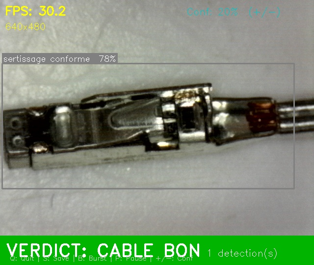
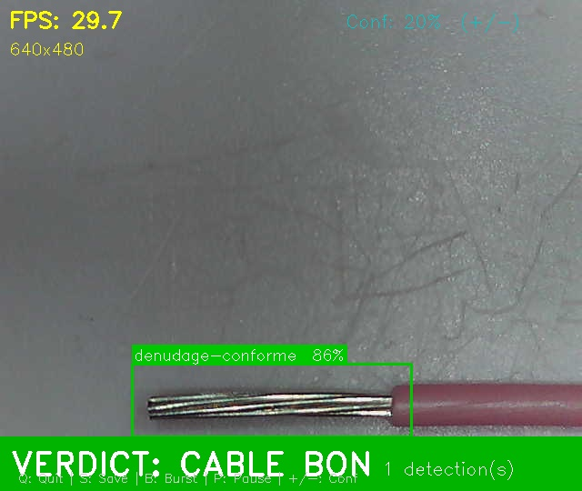
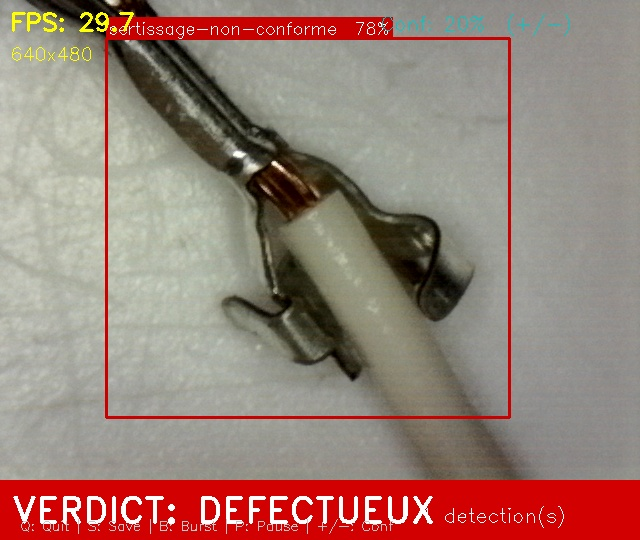
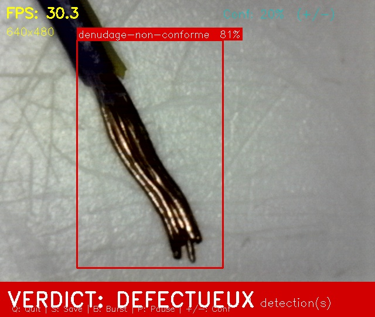

# 🔍 Automated Quality Control for Cable Crimping & Stripping Defects

> YOLOv8-based real-time defect detection system deployed on Raspberry Pi 5 for industrial cable quality inspection at LEONI Wiring Systems Tunisia.


---

## 📸 Detection Examples

### ✅ Conforme (OK)
<p align="center">
  
  
</p>

### ❌ Non-Conforme (Defective)
<p align="center">
  
  
</p>

---

## 📋 Overview

This project implements an **automated visual inspection system** for detecting crimping and stripping defects on electrical cables in a production environment. The system uses a **YOLOv8s** object detection model trained on a custom dataset, optimized with **NCNN** format for edge deployment on a **Raspberry Pi 5**.

### Key Results

| Metric | Value |
|--------|-------|
| **mAP@50 (global)** | 0.88 |
| **Inference speed** | ~30 FPS on RPi5 |
| **Classes detected** | 4 |
| **Dataset size** | ~1000 images |

### Detected Defect Classes

| Class | Description | Verdict |
|-------|-------------|---------|
| `sertissage_conforme` | Correct crimp | ✅ CABLE BON |
| `sertissage_non_conforme` | Defective crimp | ❌ DEFECTUEUX |
| `denudage_conforme` | Correct strip | ✅ CABLE BON |
| `denudage_non_conforme` | Defective strip | ❌ DEFECTUEUX |

---

## 🏗️ System Architecture

```
Camera (640x480) → RPi5 → YOLOv8s (NCNN) → Multi-Image Voting → Verdict (BON / DEFECTUEUX)
```

### Multi-Image Voting Logic

To ensure robust decisions in a production environment, the system captures **5 consecutive images** and applies a voting mechanism:

- **Conformity** is declared only if all 5 images agree
- **FC1 Safety Rule**: absence of detection ≠ conformity — if no object is detected, the cable is flagged as **DEFECTUEUX**

---

## 📁 Project Structure

```
├── src/
│   ├── train.py              # Model training script (YOLOv8)
│   ├── inference.py          # Real-time inference on Raspberry Pi
│   └── utils.py              # Helper functions
├── config/
│   └── training_config.yaml  # Training hyperparameters
├── assets/                   # Detection result screenshots
├── requirements.txt
├── .gitignore
├── LICENSE
└── README.md
```

---

## ⚙️ Training Configuration

The model was trained iteratively, with key hyperparameter tuning to resolve class-specific performance issues (sertissage class mAP improved from **0.29 → 0.62**):

```yaml
model: yolov8s.pt          # Transfer learning from COCO
epochs: 150
imgsz: 640
batch: 32
lr0: 0.005
degrees: 0                  # Rotation disabled — hurts crimp detection
mixup: 0                    # Disabled — improved precision
copy_paste: 0               # Disabled — reduced false positives
```

> **Lesson learned**: Aggressive augmentations (rotation, mixup, copy-paste) degraded performance on the sertissage class. Disabling them was the decisive improvement.

---

## 🚀 Deployment

### Hardware
- **Raspberry Pi 5** (8 GB RAM)
- USB camera (640×480)
- Custom 3D-printed inspection station

### Model Export to NCNN

```python
from ultralytics import YOLO

model = YOLO("best.pt")
model.export(format="ncnn")
```

---

## 🛠️ Getting Started

### Prerequisites

```bash
python >= 3.9
pip install -r requirements.txt
```

### Training

```bash
python src/train.py
```

### Inference (Raspberry Pi)

```bash
python src/inference.py --model models/best_ncnn_model --source 0
```

---

## 💡 Key Challenges & Lessons

1. **Domain Gap** — Model trained on controlled studio images initially performed poorly on production-line images. Collecting real production data was essential.
2. **Augmentation trade-offs** — Standard augmentations can hurt small, orientation-sensitive defect classes.
3. **Edge deployment** — Balancing accuracy with inference speed on RPi5.
4. **Safety-first logic** — In industrial QC, false negatives are more costly than false positives — the FC1 rule reflects this.

---

## 👤 Author

**Mohamed Ibrahim Bchir**
Summer Internship — LEONI Wiring Systems Tunisia, 2026

## 📄 License

This project is licensed under the MIT License — see the [LICENSE](LICENSE) file for details.

## 🙏 Acknowledgments

- [Ultralytics YOLOv8](https://github.com/ultralytics/ultralytics)
- [Roboflow](https://roboflow.com/) for dataset management
- LEONI Wiring Systems Tunisia for the industrial context and support
